<div align="center">

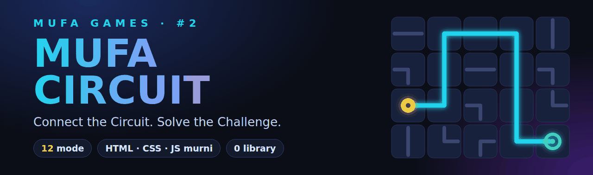

<br>

[](https://faris-it.github.io/circuit-game/)


**Puzzle logika sirkuit untuk browser. Putar ubin, alirkan energi, selesaikan tantangan.**
12 mode permainan, tanpa library, tanpa server, tanpa aset eksternal.

</div>

<br>

<div align="center">
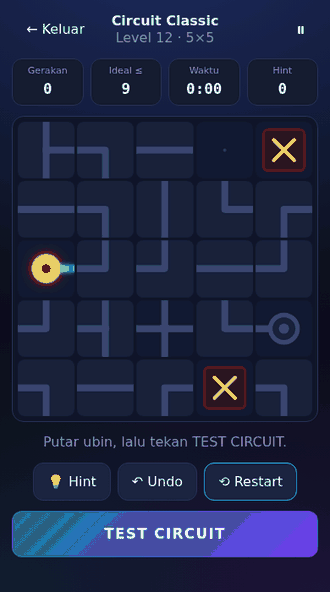
</div>

## Kenapa Mufa Circuit?

- **12 mode yang benar-benar berbeda.** Dari Classic yang santai sampai Circuit Master yang menggabungkan beberapa aturan sekaligus, termasuk dua papan yang saling memengaruhi.
- **Tidak ada puzzle yang mustahil.** Setiap level dibuat dari jalur solusi lebih dulu, lalu diacak, dan diverifikasi solver sebelum dimainkan.
- **Mesin sirkuit sungguhan.** Energi dihitung dari data koneksi tiap ubin, bukan sekadar mencocokkan gambar, sehingga mode baru bisa ditambah tanpa menulis ulang logika inti.
- **Nol dependensi.** HTML, CSS, dan JavaScript murni. Gambar dibuat dengan CSS dan SVG inline. Cukup buka `index.html`.
- **Ramah semua perangkat.** Mouse, keyboard, dan layar sentuh. Di ponsel potret, mode Dual Circuit menumpuk kedua papan secara vertikal agar ubin tetap nyaman disentuh.
- **Aksesibel.** Warna selalu disertai simbol dan pola garis, ada opsi kurangi animasi, dan papan bisa dijelajahi dengan keyboard.
- **Progres tersimpan di perangkatmu.** Skor, bintang, statistik, dan 12 achievement memakai `localStorage`. Tanpa akun dan tanpa server.

## 12 Mode

| | Mode | Level | Intinya |
|:-:|---|:-:|---|
| ⚡ | **Circuit Classic** | 17 | Hubungkan satu Source ke satu Target. Papan 4×4 sampai 7×7, tanpa batas waktu |
| ⏱ | **Time Attack** | sesi | Selesaikan sebanyak mungkin puzzle dalam 120 detik |
| ▦ | **Circuit Maze** | 12 | Papan penuh penghalang dan ubin terkunci, dengan batas gerakan |
| ⑂ | **Multi Target** | 12 | Nyalakan 2 sampai 4 Target sekaligus; satu putaran bisa memutus jalur lain |
| ◈ | **Move Limit** | 12 | Gerakan terbatas dan tanpa undo |
| ◉ | **Memory Circuit** | 10 | Papan benar tampil sebentar, lalu disembunyikan. Bangun ulang dari ingatan |
| ☀ | **Daily Circuit** | 1/hari | Satu puzzle yang sama untuk semua pemain pada tanggal itu, lengkap dengan streak harian |
| ◧ | **Color Logic** | 12 | Source berwarna, Filter, Mixer, dan Splitter. Jalur tersambung belum tentu benar |
| ≋ | **Unstable Grid** | 10 | Tiap 12 detik satu ubin berubah arah sendiri. Siapkan jalur yang bisa diperbaiki |
| ⧉ | **Dual Circuit** | 10 | Dua papan, dua sirkuit. Ubin bersama memutar kembarannya di papan lain |
| ∞ | **Endless Circuit** | sesi | Puzzle beruntun yang makin sulit, 3 nyawa, batas gerakan dan waktu per puzzle |
| ★ | **Circuit Master** | 12 | Setiap level menggabungkan 2 sampai 3 mekanik, misalnya Memory + Move Limit |

<details>
<summary><b>Aturan lengkap tiap mode</b></summary>

<br>

| Mode | Aturan khusus |
|---|---|
| Circuit Classic | Tanpa batas; bintang dari gerakan, waktu, dan hint |
| Move Limit | Batas gerakan, undo dimatikan; kalah jika gerakan habis |
| Circuit Maze | Banyak penghalang dan ubin terkunci (sudut ungu); ada batas gerakan, undo dihitung sebagai gerakan |
| Multi Target | 2–4 Target harus menyala sekaligus; simpang-T dan persimpangan membagi aliran |
| Time Attack | Puzzle terus bertambah dan makin besar; poin = 100 × (ukuran − 3) + 1 poin per detik sisa waktu; hint dimatikan |
| Memory Circuit | Papan benar tampil beberapa detik, lalu sebagian besar ubin disembunyikan (?); segitiga ungu menandai arah putar; 3 TEST gagal = kalah; hint dimatikan |
| Daily Circuit | Seed dari tanggal lokal; hanya hasil pertama yang resmi, latihan ulang tidak mengganti hasil; streak dan waktu terbaik tersimpan |
| Color Logic | Source berwarna, Target menuntut warna tepat, Filter menahan warna lain, Mixer (cyan + kuning → hijau), simpang-T sebagai splitter; warna selalu disertai simbol dan pola garis |
| Unstable Grid | Tiap 12 dtk satu ubin tidak permanen berubah arah, diumumkan 1 dtk sebelumnya; ubin permanen bertanda cincin cyan; undo dimatikan |
| Dual Circuit | Dua papan berdampingan (atau bertumpuk di ponsel potret), masing-masing punya Source dan Target; kedua sirkuit harus aktif bersamaan. Ubin bertanda ⧉ berputar bersama kembarannya. Undo ikut mengembalikan kembarannya |
| Endless Circuit | 3 nyawa: gerakan atau waktu habis = nyawa berkurang dan streak putus. Poin = 100 × (ukuran − 3) + sisa detik + 25 per streak (maks 250). Undo dan hint dimatikan; rekor: skor, puzzle terbaik, streak terbaik |
| Circuit Master | Level terbuka berurutan; aturan gabungan dijelaskan sebelum level dimulai, tanpa tutorial baru di tengah level |

</details>

## Tampilan

<table>
  <tr>
    <td width="50%">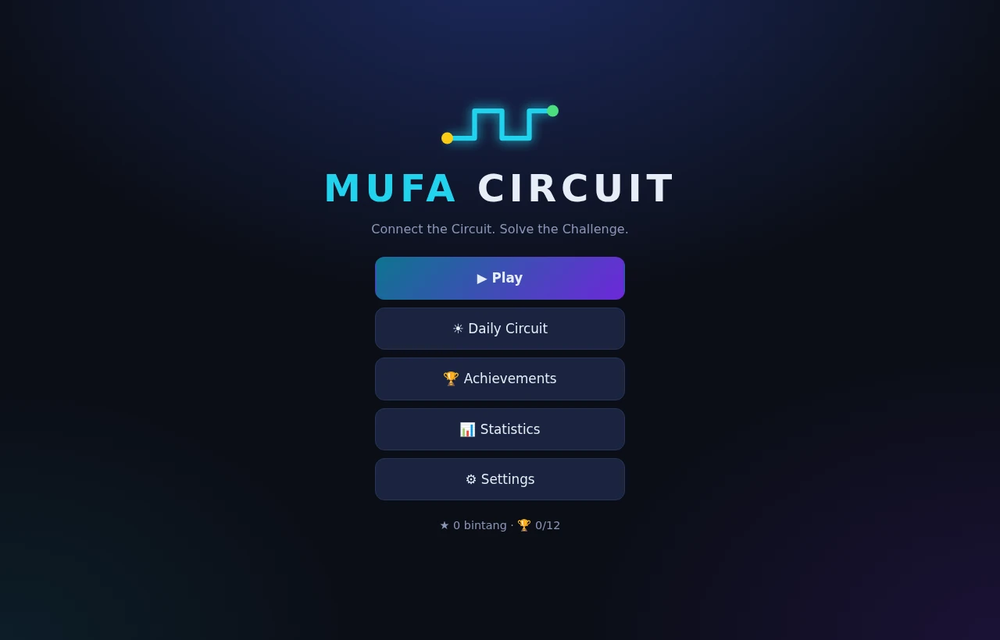<br><sub><b>Menu utama</b></sub></td>
    <td width="50%">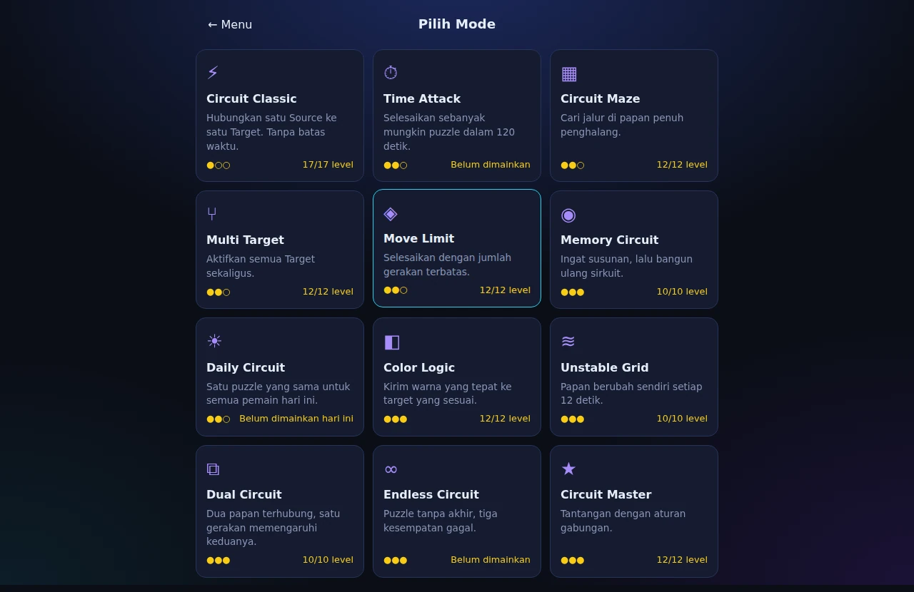<br><sub><b>12 mode, lengkap dengan progres</b></sub></td>
  </tr>
  <tr>
    <td>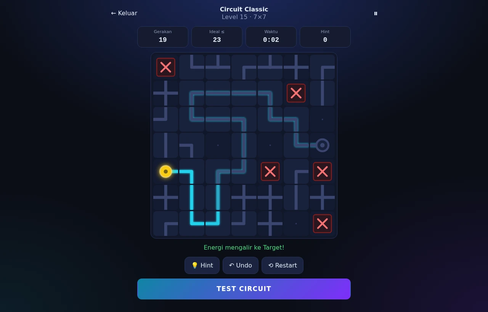<br><sub><b>Energi mengalir dari Source ke Target (7×7)</b></sub></td>
    <td>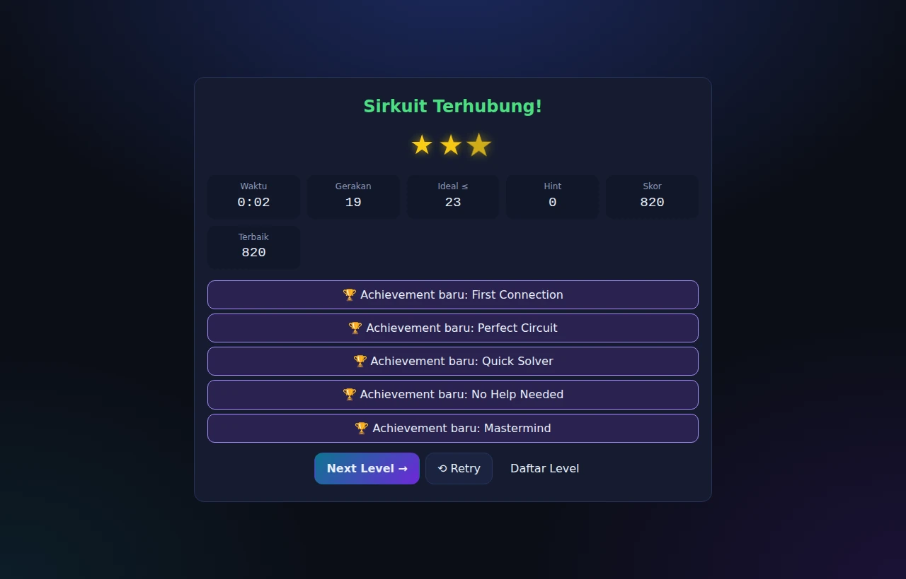<br><sub><b>Bintang, skor, dan achievement</b></sub></td>
  </tr>
  <tr>
    <td>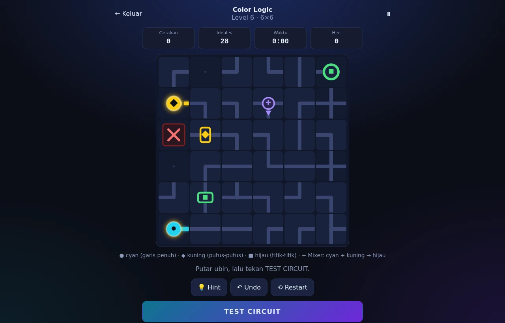<br><sub><b>Color Logic: warna harus tepat, bukan sekadar tersambung</b></sub></td>
    <td>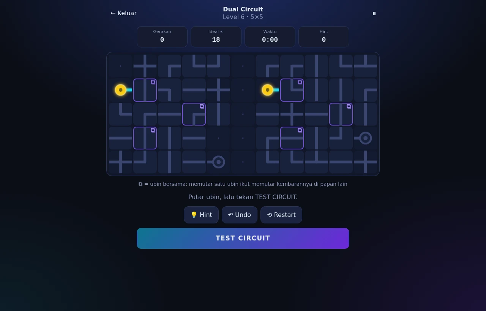<br><sub><b>Dual Circuit: ubin ⧉ memutar kembarannya</b></sub></td>
  </tr>
  <tr>
    <td>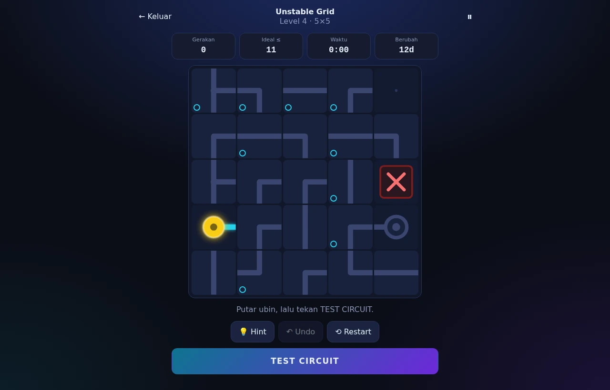<br><sub><b>Unstable Grid: papan berubah sendiri</b></sub></td>
    <td>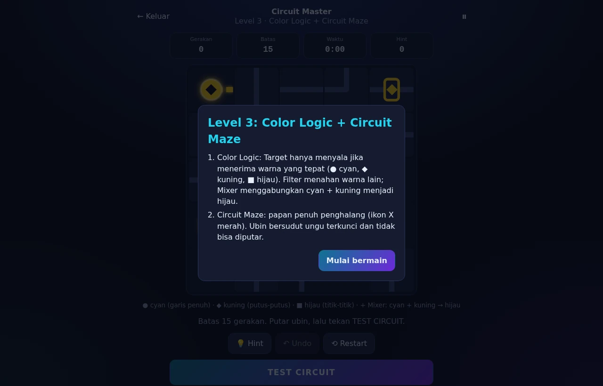<br><sub><b>Circuit Master: aturan gabungan dijelaskan di awal</b></sub></td>
  </tr>
</table>

<div align="center">
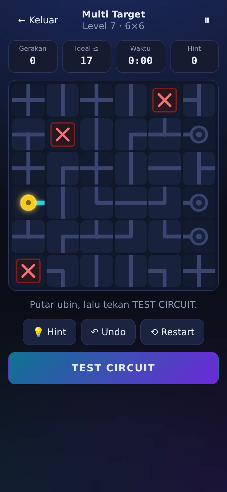
&nbsp;&nbsp;
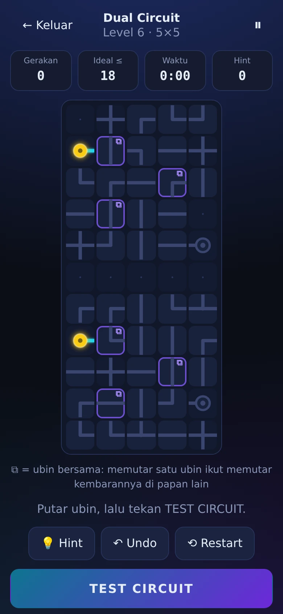
<br><sub><b>Di ponsel: Multi Target dan Dual Circuit dengan papan bertumpuk</b></sub>
</div>

## Cara bermain

1. Cari **Source** (lingkaran kuning) dan **Target** (cincin).
2. Klik atau ketuk ubin untuk memutarnya 90° searah jarum jam.
3. Tekan **TEST CIRCUIT**. Energi mengalir; titik merah menandai tempat energi bocor.
4. Raih bintang: ★ selesai, ★★ tanpa hint, ★★★ tanpa hint dan gerakan ≤ ideal (atau waktu cepat).

<details>
<summary><b>Kontrol</b></summary>

<br>

| Aksi | Desktop | Mobile |
|---|---|---|
| Memutar ubin | Klik atau Spasi | Ketuk |
| Menguji sirkuit | Enter | Tombol TEST CIRCUIT |
| Undo | Z | Tombol Undo |
| Restart | R | Tombol Restart |
| Hint | H | Tombol Hint |
| Jeda | Esc | Tombol jeda |
| Pindah fokus ubin | Tombol panah | |

Pintasan keyboard diabaikan saat kamu mengetik di kolom input.

</details>

## Jalankan sendiri

Tidak perlu build, package manager, atau server khusus.

```bash
git clone https://github.com/Faris-IT/circuit-game.git
cd circuit-game
# lalu buka index.html di browser
```

Skrip dimuat dengan tag `<script>` biasa (bukan ES module), jadi game juga jalan langsung dari `file://`. Untuk menayangkannya, unggah foldernya ke hosting statis mana pun.

<details>
<summary><b>Tayangkan di GitHub Pages</b></summary>

<br>

Repo ini sudah menyertakan workflow `.github/workflows/pages.yml`.

1. Buka **Settings → Pages**.
2. Pada **Source**, pilih **GitHub Actions**.
3. Push ke branch `main` (atau `master`). Game tayang di `https://<username>.github.io/<nama-repo>/`.

Workflow hanya menerbitkan file game (`index.html`, `css`, `js`, `modes`, `data`, `docs`), bukan folder uji.

</details>

## Pengujian

Game tidak dianggap selesai hanya karena halamannya bisa dibuka.

```bash
node tests/run-tests.js     # 31 pemeriksaan logika, tanpa dependensi
python tests/e2e.py         # opsional: uji di browser (pip install playwright)
```

| Pemeriksaan | Cakupan |
|---|---|
| Setiap level bisa diselesaikan dan tidak mulai dalam keadaan selesai | 107 level semua mode + 600 puzzle Endless acak |
| Solver dan hint | Semua mode diselesaikan hanya dengan mengikuti hint, dalam batas gerakan |
| Dual Circuit | Undo simetris pada ubin bersama; susunan berdampingan dan vertikal terselesaikan dengan par yang benar |
| Memory Circuit | Susunan hafalan benar dan bisa dibangun ulang |
| Endless dan Master | Alur nyawa, skor, streak, batas waktu; setiap level Master punya ≥ 2 mekanik |
| Data rusak | `localStorage` berisi JSON rusak, tipe salah, atau terblokir tidak membuat game gagal dibuka |
| Layar | 12 mode di desktop, tablet, dan ponsel: tanpa overflow dan tanpa error JavaScript |
| Progres | Skor, bintang, dan achievement bertahan setelah reload |
| Input | Spasi, Enter, Z, R, H, Esc, panah, dan opsi kurangi animasi |

## Teknologi

HTML5, CSS3 (Grid), JavaScript ES6+, SVG inline, dan `localStorage`.
Tanpa framework, library, gambar/audio/font eksternal, backend, atau internet saat bermain.

## Arsitektur

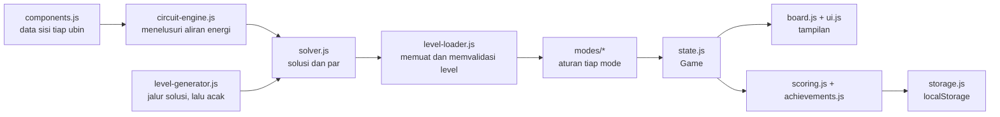

<details>
<summary><b>Struktur folder</b></summary>

<br>

```
index.html
css/    themes, style, layout, board, animations
js/     config, storage, components, circuit-engine, solver, level-generator,
        level-loader, scoring, achievements, state, board, ui, input, main
modes/  classic, move-limit, maze, multi-target, time-attack, memory, daily,
        color-logic, unstable-grid, dual-circuit, endless, master
data/   levels-classic.js, levels-master.js
tests/  run-tests.js (logika, node), e2e.py (browser, opsional)
docs/   banner, demo.gif, screenshots (hanya untuk README, bukan bagian game)
```

</details>

<details>
<summary><b>Keputusan desain</b></summary>

<br>

- Energi dihitung dari data koneksi aktual tiap ubin (`circuit-engine.js`), bukan dari tampilan.
- Level prosedural dibuat dari jalur solusi lebih dulu, lalu rotasinya diacak; `solver.js` memverifikasi dan menghitung gerakan minimum (par). Hint berasal dari solusi yang sama.
- Multi Target dibangun dari pohon sirkuit; solusinya disimpan di `board.solution`, diverifikasi mesin sirkuit, dan dipakai untuk hint serta par.
- Level buatan tangan menyimpan susunan terselesaikan; rotasi diacak deterministik saat dimulai.
- Dual Circuit digabung menjadi satu papan (A, pemisah kosong, B). Pemisah memutus aliran antar papan, jadi mesin sirkuit yang sama dipakai tanpa perubahan. Pasangan ubin bersama disimpan di `board.twins`; rotasi awalnya diatur sehingga selalu ada jumlah klik yang membenarkan kedua ubin sekaligus. Hint dan par dihitung per satuan putar, bukan per ubin. Di ponsel potret, kedua papan ditumpuk vertikal.
- Circuit Master memakai hook mode yang sudah ada (Unstable Grid, Memory Circuit) lewat delegasi, dan level boleh menimpa aturan mode lewat `lv.rules` (misalnya undo dimatikan saat ada batas gerakan).
- Mode sesi (Time Attack, Endless) memakai alur `run`; Endless menambah hook `lose`, `next`, `stars`, dan `summary`.
- Restart: gerakan dihitung ulang, sedangkan hint yang sudah dipakai dan waktu tetap berlaku.
- Data `localStorage` divalidasi saat dimuat; data rusak diganti nilai bawaan.

</details>

## Rencana ke depan

Di luar versi pertama, dan baru dipertimbangkan setelah game inti stabil:
multiplayer, akun dan login, leaderboard global, sinkronisasi cloud, editor level publik, dan monetisasi.
Leaderboard serta pencapaian lintas-game akan menjadi urusan integrasi dengan platform Mufa Games.

## Lisensi

[MIT](LICENSE) © 2026 Muhammad Faris

<div align="center">
<sub>Game #2 dari <b>Mufa Games</b> · dibuat oleh <a href="https://github.com/Faris-IT">Muhammad Faris</a></sub>
</div>
